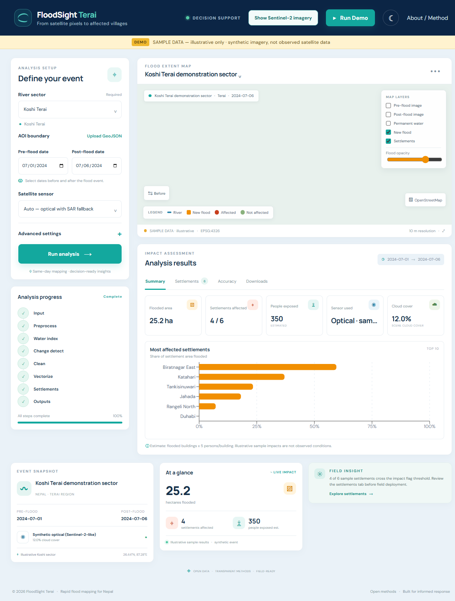
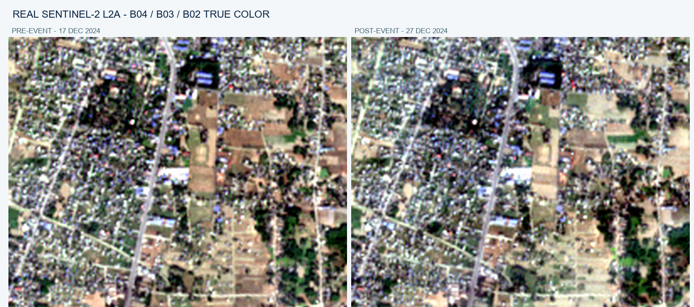

# FloodSight Terai

**From satellite pixels to affected villages.** A flood mapping and settlement-impact dashboard for Nepal's Terai region, with an offline, illustrative demo and a Planetary Computer real-scene workflow.

> **Important:** Run Demo uses synthetic imagery and example settlement data. It is labelled throughout the UI and is not an observation of an actual flood. Accuracy scores are only displayed when a reference flood mask is provided; the demo has none.

## Architecture

```text
React + Vite + TypeScript dashboard
  ├─ MapLibre map, controls, progress, results, downloads
  └─ FastAPI JSON / PNG / file endpoints
       ├─ Background analysis jobs + status polling
       ├─ pipeline/data_fetch.py  Planetary Computer STAC scenes
       ├─ pipeline/preprocess.py  SCL validity + common-grid helpers
       ├─ pipeline/water.py       Otsu NDWI/MNDWI or SAR classification
       ├─ pipeline/change.py      new flood, morphology, slope filter
       ├─ pipeline/vectorize.py   flood polygons and area
       ├─ pipeline/settlements.py OSM lookup, flag rules, exposure estimate
       ├─ pipeline/validate.py    reference-mask metrics
       └─ sample_data/            synthetic offline demo + cached real Sentinel-2 pair
```

## Screenshot

The screenshot below is from the local browser-verified demo. All results shown are illustrative synthetic sample data.



## Real Sentinel-2 imagery

These are actual Planetary Computer Sentinel-2 L2A true-color composites over the Koshi demo sector, selected for 17 and 27 December 2024. The comparison is a clear dry-season example, not a documented flood event; the zero detected new flood extent must not be interpreted as flood validation.



Select **Show Sentinel-2 imagery** in the dashboard to view the cached pair offline. **Run Demo** remains a separate synthetic, illustrative flood scenario.

## Requirements and setup

- Python 3.11 (the code was also smoke-tested with Python 3.14 in the development environment)
- Node.js 20+ and npm
- No credentials or internet connection are needed to view either saved example. The first backend start creates synthetic sample files if they are missing; the cached real Sentinel-2 pair is included under `sample_data\real_sentinel`.
- Real-scene mode needs network access to Planetary Computer and OpenStreetMap; no Google Earth Engine is used.

### Backend

In PowerShell, from the repository root:

```powershell
py -3.11 -m venv .venv
.\.venv\Scripts\Activate.ps1
python -m pip install -r backend\requirements.txt
Set-Location backend
python -m uvicorn app.main:app --reload --host 127.0.0.1 --port 8000
```

The API is at `http://127.0.0.1:8000`; interactive API docs are at `/docs`.

### Frontend

In another PowerShell terminal, from the repository root:

```powershell
Set-Location frontend
npm install
npm run dev
```

Open `http://127.0.0.1:5173`. The frontend calls the local backend at `http://127.0.0.1:8000/api`.

### Offline demo

1. Start both servers using the commands above.
2. Select **Run Demo** in the header (or **Load illustrative demo** on the map).
3. Explore the illustrative flood polygon and settlement impact table; switch layers, search/filter/sort settlements, and download the sample outputs.
4. Use the Accuracy tab to see the honest **No reference mask provided** state.
5. Select **Show Sentinel-2 imagery** to compare the real, clear-scene satellite images. The banner explains that it is a dry-season image example, not a flood event.

No live data is fetched by either saved-example endpoint. The synthetic sample raster set and cached real Sentinel-2 raster pair are stored in `sample_data/`.

## Real-scene analysis

Use the dashboard to choose an AOI and pre/post dates, then select Auto, Optical, or SAR. Or run:

```powershell
Set-Location backend
python -m pipeline.run --aoi ..\sample_data\aoi.geojson --pre 2024-07-01 --post 2024-07-06 --out ..\results\terai-demo
```

Optional CLI parameters are `--sensor auto|optical|sar`, `--index mndwi|ndwi|both`, `--min-area-ha` (default 2), and `--flag-threshold-pct` (default 10).

The real-data workflow searches Microsoft Planetary Computer for Sentinel-2 L2A scenes around both target dates, selecting a pre-date acquisition on or before the pre-event date and a post-date acquisition on or after the post-event date. Each search is constrained to the configured ±15-day window and chooses the least-cloudy scene. The dashboard displays and lets you download actual Sentinel-2 true-color composites (B04/B03/B02) alongside the flood layers. Auto switches to Sentinel-1 RTC when scene cloud cover exceeds the configured 40% limit. The SAR workflow median-filters VV and classifies dark pixels with Otsu. Both branches calculate a Copernicus DEM slope filter, detect newly wet pixels, polygonize the result, query/cache AOI OpenStreetMap settlements, buildings and residential areas, estimate settlement exposure, and write GeoTIFF, GeoJSON, CSV, standalone HTML map, and PDF outputs.

The interactive dashboard uses OpenStreetMap map tiles with visible attribution for roads, place labels and rivers. Real-scene analysis queries OSM for place boundaries, residential landuse and building footprints; results report the number of OSM buildings evaluated. If place boundaries are absent, residential landuse areas are used as settlement-area proxies. The bundled real imagery can also be viewed offline, while the OSM tile basemap itself needs internet. For a live refresh near the Koshi demo AOI, try pre-flood `2024-12-17` and post-flood `2024-12-27` with **Optical — Sentinel-2**. These dates demonstrate real, low-cloud imagery, not a documented flood event; do not interpret a zero/low change result as evidence that no flood occurred.

Real-scene requests require working external access and STAC assets. If no matching scenes, DEM data, or OSM response/cache is available, the job reports an explicit error instead of substituting synthetic results. Scene-level cloud metadata is used as the practical cloud-cover proxy; it is not a per-pixel AOI cloud fraction.

## Configuration and methods

Pipeline defaults live in [backend/pipeline/config.py](backend/pipeline/config.py):

- Cloud limit: 40%
- Scene date window: ±15 days
- Minimum flood polygon/object: 2 ha
- Settlement area flag threshold: 10%
- Estimated people per flooded building: 5
- Optical water agreement: both indices
- Slope rejection above: 5°
- Minimum speckle cleanup: 2 pixels

Optical indices:

```text
NDWI  = (Green - NIR) / (Green + NIR)
MNDWI = (Green - SWIR) / (Green + SWIR)
```

Each scene's index thresholds are Otsu-derived. New flood is post-event water AND NOT pre-event water; known pre-event water is therefore excluded. A settlement is flagged when any building is flooded **or** at least the configured percentage of its area is flooded. Severity is High at ≥50%, Medium at ≥20% and Low for other affected settlements. Exposure is an estimate (flooded buildings × persons/building), not a census count.

## API

- `POST /api/analyze` — create a background analysis job
- `GET /api/jobs/{id}` — status, step, percentage and logs
- `GET /api/results/{id}` — completed result data and file links
- `GET /api/results/{id}/layers/{layer}` — map PNG overlay with `X-Bounds`
- `GET /api/presets` — Koshi, Bagmati and Gandaki example sectors
- `GET /api/demo` — saved offline result
- `GET /api/real-demo` — cached Planetary Computer Sentinel-2 example with true-color downloads

## Tests and quality checks

```powershell
Set-Location backend
python -m pytest tests -q
Set-Location ..\frontend
npm run build
npm run lint
```

The pipeline tests cover normalized water indices, optical agreement, flood differencing, settlement flag/severity rules, ordered pre/post scene windows and reference-mask metrics.

## Known limitations

- Planetary Computer, Copernicus DEM, OpenStreetMap tiles and OSM feature access need an internet connection. The saved demo analysis data does not; without internet, OSM basemap tiles are unavailable.
- Optical scene cloud cover is item metadata, not a cloud percentage calculated only within the AOI. SCL is used to exclude invalid pixels during classification.
- Sentinel-2 revisit timing, monsoon clouds, mixed pixels and SAR speckle can affect flood delineation.
- OSM settlement/building coverage is incomplete and uneven; building-based population is explicitly an estimate.
- The approximate basin presets are starting areas, not authoritative hydrological boundaries; upload a reviewed AOI GeoJSON for operational work.
- Validation metrics remain absent until a reference mask is supplied to the validation module. No accuracy figures are inferred from synthetic data.
- This is a decision-support prototype, not an authoritative emergency-management product. Review outputs with local authorities and field observations.
